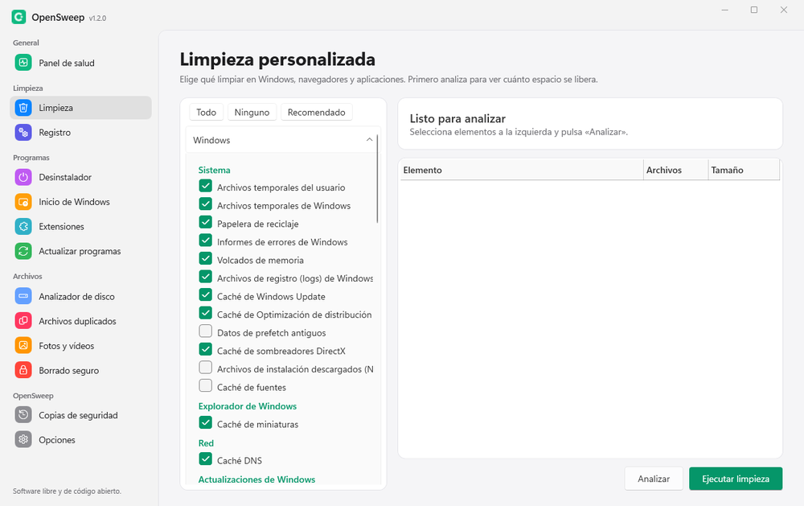
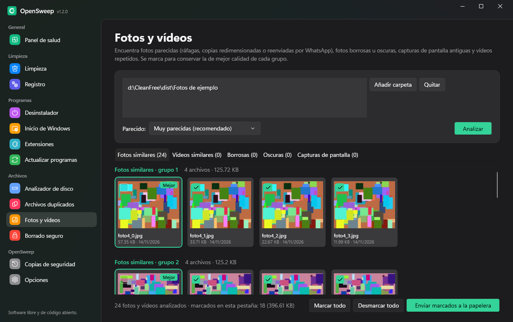
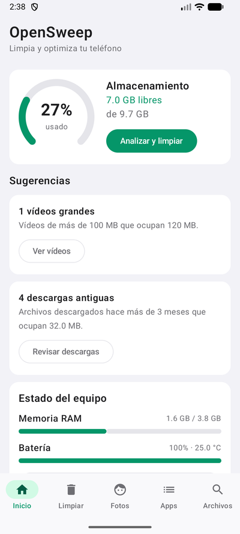
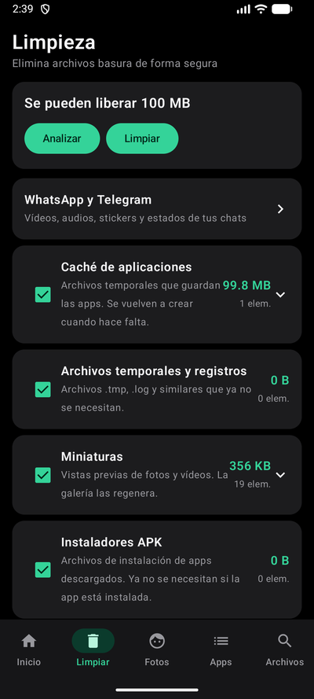
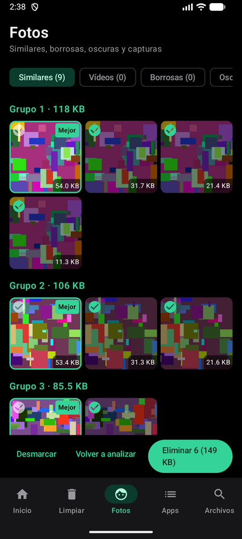

<p align="center">
  
</p>

<h1 align="center">OpenSweep</h1>

<p align="center">
  Limpiador, desinstalador y optimizador <b>libre y de código abierto</b> para <b>Windows</b> y <b>Android</b>.
</p>

OpenSweep reúne en una sola app lo que normalmente necesitas varios programas para hacer: limpiar archivos basura, reparar el registro, desinstalar programas **sin dejar restos**, controlar el arranque de Windows, encontrar duplicados y archivos grandes, y mantener tus programas actualizados. Sin anuncios, sin telemetría y sin versiones «Pro».

## Capturas

<p align="center">
  
  
</p>
<p align="center">
  
  
  
</p>

## Descargas

Ve a [**Releases**](https://github.com/jromo16/OpenSweep/releases) y descarga:

| Plataforma | Archivo | Requisitos |
|---|---|---|
| Windows (instalador) | `OpenSweep-Setup.exe` | Windows 10/11 de 64 bits. Recomendado: crea accesos directos y se actualiza solo. |
| Windows (portable) | `OpenSweep-windows.exe` | Windows 10/11 de 64 bits. No necesita instalación. |
| Android | `OpenSweep-android.apk` | Android 8.0 o superior. |

> En Android, activa «Instalar apps desconocidas» para tu navegador o gestor de archivos la primera vez.

## Funciones

Diseño moderno inspirado en macOS, con **modo claro y oscuro** automático. Novedades de cada versión en el [historial de cambios](CHANGELOG.md).

### Windows

| Módulo | Qué hace |
|---|---|
| **Panel de salud** | Análisis en un clic: basura, registro y programas de inicio, con botón «Mejorarlo ahora». Muestra sistema, CPU, RAM, discos y la **salud de cada disco** (S.M.A.R.T.: estado, temperatura y vida útil del SSD). Incluye **Reparar Windows** (DISM + SFC). |
| **Limpieza** | Temporales de usuario y de Windows, papelera, miniaturas, informes de errores, volcados de memoria, logs, caché de Windows Update y de Optimización de distribución, prefetch, caché de sombreadores DirectX/NVIDIA/AMD, caché DNS. Navegadores: Chrome, Edge, Brave, Vivaldi, Opera, Opera GX y Firefox (caché, historial, cookies, sesión y formularios). Apps: Discord, Spotify, Teams, VS Code, Steam, Zoom, Slack, WhatsApp, Office, Epic Games, Adobe, npm, pip, NuGet y Java. Privacidad: documentos recientes, Jump Lists, historial de Ejecutar y portapapeles. Permite añadir carpetas propias y exclusiones. Opcionalmente, las **reglas de la comunidad winapp2** (más de 2.000 programas y juegos). |
| **Registro** | Detecta DLL compartidas que faltan, entradas de desinstalación huérfanas, rutas de aplicaciones inválidas, caché MUI, programas de inicio rotos, carpetas del instalador, archivos de ayuda y extensiones sin asociación. **Guarda una copia `.reg` antes de reparar.** |
| **Desinstalador** | Lista todos los programas (64/32 bits, por usuario y para todos) con icono, tamaño y fecha. Un **asistente paso a paso** ejecuta el desinstalador oficial y después **busca restos** (carpetas, accesos directos, claves y valores del registro, inicio automático, App Paths, servicios, tareas programadas, reglas del firewall, menús contextuales, asociaciones de archivos, temporales, historial de compatibilidad y Prefetch), los muestra en árbol y los envía a la Papelera de reciclaje, en modo Seguro, Moderado o Avanzado. Incluye **desinstalación forzada** para programas rotos, desinstalación de **apps de la Microsoft Store**, **punto de restauración** automático, **modo cazador** (suelta la mira sobre la ventana de un programa o arrastra un acceso directo) y **monitor de instalaciones**, manual o **automático en segundo plano** (registra todo lo que crea un instalador para desinstalarlo después sin dejar rastro) y **desinstalación por lotes** (varios programas seguidos, con una sola búsqueda de restos al final). Marca los programas nuevos, permite comentarios, ocultar programas y exportar la lista. |
| **Inicio de Windows** | Habilita, deshabilita o elimina programas de inicio (registro y carpeta Inicio) y tareas programadas. Usa el mismo mecanismo que el Administrador de tareas, así que los cambios son reversibles. |
| **Extensiones** | Lista y elimina extensiones de Chrome, Edge, Brave, Vivaldi, Opera y Firefox. |
| **Analizador de disco** | **Mapa visual** de carpetas en el que se puede entrar con doble clic, uso por tipo de archivo, carpetas más pesadas y los 500 archivos más grandes. |
| **Privacidad de Windows** | Desactiva el ID de publicidad, la telemetría opcional, los anuncios de Inicio y de la pantalla de bloqueo, Bing en la búsqueda, el historial de actividad, Recall y Copilot. Todo se puede deshacer. |
| **Archivos duplicados** | Compara el contenido con SHA-256 (no solo el nombre), con miniaturas. Envía las copias a la papelera y nunca deja que borres todas las copias de un grupo. |
| **Fotos y vídeos** | Fotos **similares** (ráfagas, copias redimensionadas o reenviadas por WhatsApp) mediante huella perceptual, fotos **borrosas** y **oscuras**, **capturas de pantalla** antiguas y **vídeos similares**. Vista en miniaturas, con la mejor foto de cada grupo marcada para conservar. |
| **Borrado seguro** | Destructor de archivos (1, 3 o 7 pasadas) y borrado del espacio libre de una unidad. Opcionalmente, «Destruir con OpenSweep» y «Desinstalar con OpenSweep» en el menú del clic derecho del Explorador. |
| **Actualizar programas** | Encuentra versiones nuevas e instala las actualizaciones en silencio con `winget`. |
| **Actualizaciones de Windows** | Elimina la instalación anterior (`Windows.old`, a veces 20-30 GB), los paquetes de controladores antiguos y los componentes de Windows Update reemplazados, usando las herramientas del propio Windows. |
| **Copias de seguridad** | **Deshace cualquier desinstalación** con un clic (registro, tareas y archivos de la papelera), restaura las copias `.reg` que se guardan antes de cada cambio y gestiona los puntos de restauración del sistema. |
| **Automático** | Limpieza programada (diaria o semanal), monitor en la bandeja del sistema que avisa cuando hay mucha basura y **limpieza de cada navegador al cerrarlo**. |
| **Cookies a conservar** | Limpia las cookies sin cerrar tu sesión en los sitios que elijas (Gmail, el banco…). |

### Android

| Módulo | Qué hace |
|---|---|
| **Inicio** | Almacenamiento, RAM y batería en tiempo real, **sugerencias** (apps que no usas, vídeos grandes, descargas antiguas), aviso de versiones nuevas e información del equipo. |
| **Papelera de 30 días** | Las fotos, vídeos, descargas y archivos que eliminas se pueden **restaurar durante 30 días**; después se borran solos. |
| **Fotos** | Fotos similares, borrosas, oscuras, capturas y vídeos similares, en cuadrícula. Conserva siempre la mejor. |
| **WhatsApp y Telegram** | Vídeos, audios, notas de voz, stickers, GIF y estados por categoría, con filtro por antigüedad y opción de excluir lo que enviaste. |
| **Avisos y widget** | Notificación diaria si hay mucha basura y widget de escritorio con el espacio libre y un botón «Limpiar». |
| **Limpieza** | **Caché de todas las apps de un toque** (con el servicio de accesibilidad, que activas tú), temporales y logs, miniaturas, APK descargados, **restos de apps desinstaladas**, carpetas vacías y descargas antiguas. |
| **Apps** | Gestor y desinstalador por lotes. Ordena por tamaño, por último uso («Sin usar») o por fecha de instalación. Después de desinstalar, **busca restos** y ofrece borrarlos. |
| **Archivos** | Uso por tipo de archivo, **mapa del almacenamiento** por carpetas, archivos grandes y duplicados (MD5). |
| **Equipo** | Modelo, Android, parche de seguridad, CPU, RAM, almacenamiento y estado de la batería. |

**Permisos de Android:** «Acceso a todos los archivos» (para buscar basura y duplicados), «Acceso de uso» (opcional, para el tamaño y el último uso de cada app), «Solicitar desinstalación de paquetes» y, si quieres borrar la caché de todas las apps, el **servicio de accesibilidad** (solo pulsa «Borrar caché» en los ajustes de cada app mientras limpias; no lee nada más). OpenSweep solo usa Internet para comprobar si hay versiones nuevas en GitHub (se puede desactivar en Ajustes). Tus archivos nunca salen del teléfono.

## Línea de comandos (Windows)

```
OpenSweep.exe --analyze  [--rules <lista>] [--include-privacy] [--log <archivo>]
OpenSweep.exe --clean    [--rules <lista>] [--include-privacy] [--log <archivo>]
OpenSweep.exe --list-rules
```

`<lista>` son identificadores de regla separados por comas (los muestra `--list-rules`), `group:Navegadores` o `all`.
Sin `--rules` se usa lo marcado en «Limpieza» (salvo el grupo Privacidad, que necesita `--include-privacy`). Con grupos o `all` solo se aplican las reglas seguras: el historial,
las cookies y las sesiones solo se borran si se nombran una a una o con `--include-privacy`.
OpenSweep pide permisos de administrador: ejecútalo desde una consola de administrador para ver la salida, o usa `--log`.

## Seguridad

- Siempre se **analiza antes de borrar** y se pide confirmación.
- Lista de **carpetas protegidas** (Windows, Program Files, perfil de usuario, etc.) que nunca se eliminan completas.
- **Copia `.reg`** antes de tocar el registro, guardada en `Documentos\OpenSweep Backups`.
- **Punto de restauración** opcional antes de desinstalar.
- Los duplicados y los archivos grandes van a la **papelera de reciclaje** (Windows) o a la **papelera de 30 días** de OpenSweep (Android).
- **Pruebas automáticas** de las funciones que borran datos: se ejecutan en cada cambio (`dotnet test windows/OpenSweep.Tests`, `./gradlew testDebugUnitTest`).
- **Prueba completa en Windows Sandbox** de todo lo que cambia el sistema. Ver [docs/PRUEBAS.md](docs/PRUEBAS.md).

## Idiomas

OpenSweep está en **español** e **inglés** y elige automáticamente según el idioma del sistema (se puede cambiar en Opciones / Ajustes).
Las traducciones están en la carpeta [`i18n/`](i18n), compartida por las dos apps. Cada archivo es un diccionario
«texto en español» → «texto traducido». Para añadir un idioma, copia `i18n/en.json` como `i18n/xx.json` (por ejemplo `pt.json`)
y traduce los valores. Para probarlo en Windows: `OpenSweep.exe --lang pt`.

## Compilar desde el código

### Windows (`windows/OpenSweep`)

Requiere el [.NET SDK 10](https://dotnet.microsoft.com/download).

```powershell
cd windows/OpenSweep
dotnet build                     # compilar
dotnet run                       # ejecutar (pedirá permisos de administrador)

# Ejecutable único y portable
dotnet publish -c Release -r win-x64 --self-contained true `
  -p:PublishSingleFile=true -p:IncludeNativeLibrariesForSelfExtract=true `
  -p:EnableCompressionInSingleFile=true -o ../../dist/windows
```

Argumentos útiles: `--page 3` abre una sección (0 = Panel, 1 = Limpieza, 2 = Registro, 3 = Desinstalador…), `--lang en` fuerza un idioma, `--tray` inicia solo el monitor de la bandeja y `--auto-clean` hace una limpieza silenciosa.

El instalador se genera con [Inno Setup 6](https://jrsoftware.org/isinfo.php): `iscc /DAppVersion=1.1.0 installer/OpenSweep.iss`.

### Android (`android/`)

Requiere JDK 17 o superior y el Android SDK (API 37). Desde Android Studio, abre la carpeta `android/`. Por línea de comandos:

```bash
cd android
./gradlew assembleDebug      # app/build/outputs/apk/debug/app-debug.apk
./gradlew assembleRelease    # app/build/outputs/apk/release/app-release.apk
```

## Estructura

```
windows/OpenSweep/
  Core/        utilidades: rutas, P/Invoke, borrado seguro, ajustes
  Services/    lógica: limpieza, registro, desinstalador, inicio, extensiones, disco, winget
  Views/       pantallas WPF (tema Fluent claro y oscuro)
windows/OpenSweep.Tests/   pruebas automáticas (xUnit)
android/app/src/main/java/io/github/jromo16/opensweep/
  core/        permisos, información del equipo, escáner de almacenamiento, gestor de apps
  ui/          tema, componentes y pantallas en Jetpack Compose
fastlane/                   ficha de la tienda (F-Droid)
packaging/                 winget y F-Droid
tools/sandbox/             prueba completa en Windows Sandbox
```

## Contribuir

¡Las contribuciones son bienvenidas! Lee [CONTRIBUTING.md](CONTRIBUTING.md). Algunas ideas:

- Más reglas de limpieza para otras aplicaciones (`Services/JunkCleaner.cs`).
- Traducciones a otros idiomas (`i18n/`).
- Más apps de mensajería en el limpiador de Android (`core/Messengers.kt`).

## Publicar versiones y firma de código

Al crear una etiqueta `vX.Y.Z`, GitHub Actions compila el instalador, el `.exe` portable y el `.apk`, y los publica en *Releases*.
Si se configuran certificados como secretos del repositorio, los firma automáticamente. Ver [docs/FIRMA.md](docs/FIRMA.md).
Para llevarla a winget y F-Droid, ver [packaging/README.md](packaging/README.md).
Política de firma de código y privacidad: [docs/CODE_SIGNING.md](docs/CODE_SIGNING.md).

## Licencia

[MIT](LICENSE). Úsalo, modifícalo y compártelo libremente.

> OpenSweep es un proyecto independiente y no está afiliado a ningún otro producto de limpieza o desinstalación.
